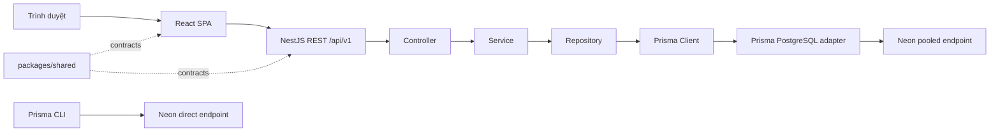
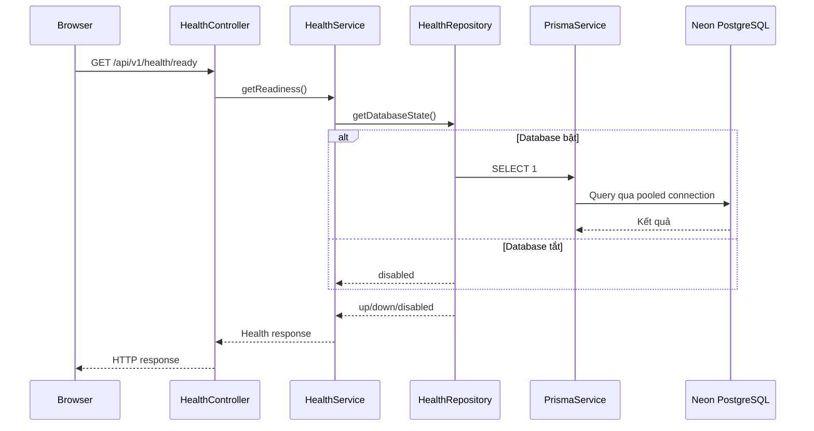

# Sprint 0 — Kiến trúc

## Tổng quan

Runtime database là tùy chọn để scaffold và CI chạy không cần secret. Khi `DATABASE_ENABLED=false`, `PrismaModule` không tạo provider hoặc mở connection.

## Ranh giới backend

- Controller xử lý HTTP, DTO và Swagger.
- Service điều phối use case và business rules.
- Repository là nơi gọi Prisma Client.
- `PrismaService` quản lý adapter, connect và disconnect.
- `prisma.config.ts` dành cho CLI; migration dùng direct endpoint.

Không có truy vấn database trong controller. Health liveness không phụ thuộc database; readiness dùng một truy vấn hằng số qua repository.

## File chính

| Thành phần             | File                                           |
| ---------------------- | ---------------------------------------------- |
| Composition root       | `apps/api/src/app.module.ts`                   |
| Environment validation | `apps/api/src/config/environment.ts`           |
| Prisma CLI config      | `apps/api/prisma.config.ts`                    |
| Prisma schema          | `apps/api/prisma/schema.prisma`                |
| Runtime module/service | `apps/api/src/database/prisma/`                |
| CLI safety wrapper     | `apps/api/scripts/prisma-database-command.cjs` |
| Neon read-only probe   | `apps/api/src/database/prisma/check-neon.ts`   |
| Health layers          | `apps/api/src/modules/health/`                 |

## Quy tắc dữ liệu

- Runtime dùng `DATABASE_URL` pooled.
- CLI dùng `DIRECT_URL` direct.
- URL phải là database development/test được phê duyệt, có TLS và channel binding.
- Migration không tự chạy lúc khởi động.
- CI không có database URL.
- Sprint 0.1 không tạo model nghiệp vụ hoặc migration rỗng.

Authentication, RBAC và business entities thuộc Sprint 1 hoặc các sprint sau.
